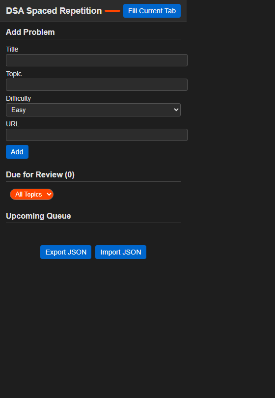

# DSA Spaced Repetition (Chrome / Brave Extension)

[](https://github.com/akshaatsingh/dsa-spaced-repetition/actions/workflows/ci.yml)
[](https://opensource.org/licenses/MIT)

A lightweight **Manifest V3** browser extension that schedules Data Structures & Algorithms (DSA) problem reviews using the **SM-2 spaced-repetition algorithm**.

---

## Preview

<p align="center">
  
</p>

---

## 1. Problem It Solves
Practicing LeetCode/DSA problems once leads to forgetting patterns within days. This extension tracks solved problems directly inside Chrome/Brave and surfaces due reviews with dynamically adjusted intervals (**Hard**, **Good**, **Easy**) based on recall quality.

## 2. Architecture & How It Works
- **`manifest.json` (Manifest V3):** Registers the extension popup, badge worker (`background.js`), and problem-site metadata extractor (`content.js`).
- **`sm2.js` (Pure ES Module Scheduler):** Implements the SM-2 ease-factor and interval state machine (`1 day → 6 days → round(interval * EF)`, resetting on `< 3` recall with a `1.3` ease-factor floor).
- **`popup.html` / `popup.js` / `popup.css`:** Manages problem capture (`Fill Current Tab`), topic filtering, due-review queue, upcoming queue, and JSON export/import persisted in `chrome.storage.local`.

## 3. Tech Stack & Trade-Offs
- **Zero-Dependency Vanilla JS + ES Modules vs. React/Bundler:** Keeps extension size tiny, requires no build step to load unpacked, and allows testing `sm2.js` directly with Node's built-in test runner.
- **`chrome.storage.local` vs. Remote Backend:** Works 100% offline with zero server setup; portable via built-in JSON export/import.

## 4. Install & Run Locally

### Load the Extension
1. Clone this repository:
   ```bash
   git clone https://github.com/akshaatsingh/dsa-spaced-repetition.git
   ```
2. Open Chrome (`chrome://extensions`) or Brave (`brave://extensions`).
3. Turn **Developer mode** **ON**.
4. Click **Load unpacked** and select the cloned `dsa-spaced-repetition` folder.

### Run Automated Tests (Node.js 18+)
```bash
node --test tests/*.test.mjs
```

## 5. Limitations & Next Steps
- **Limitations:** Schedules sync locally per browser profile (`chrome.storage.local`) rather than across devices without manual JSON export/import.
- **Next Steps:** Add `chrome.storage.sync` option and GitHub/LeetCode submission auto-detection.

## License
MIT — see [LICENSE](LICENSE).
